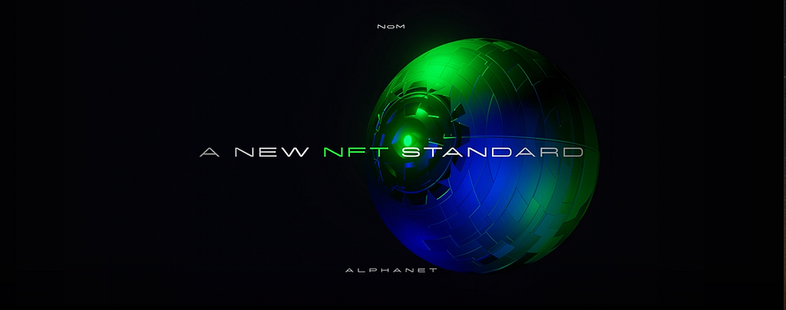

# zenon-nft

A one-page explainer of **threshold release**, the way the unlockable content of
the Zenon NFT standard would open: the content key is sealed once to a committee
of Sentinels, and whoever the ledger says holds the item can open it. A transfer
is a plain send.

**Live page:** https://sol-znn.github.io/zenon-nft/

The standard comes from the Zenon Network article
[The New NFT Standard: when cryptography meets steganography](https://medium.com/@zenon.network/the-new-nft-standard-when-cryptography-meets-steganography-9e356007dcaa)
(Medium, 2022-05-01). It asks for a Virtual Hologram embedded in the media and
for content that only the holder can reveal. This page covers the second part.

## What the page shows

| Section | What it is |
|---|---|
| How an item opens | A 13-step sequence: mint, seal, open, transfer, a refused request, the next holder opening the same file |
| Try the committee | Set the number of Sentinels and the threshold, take nodes offline or make them collude, and watch real secret-sharing arithmetic join or fail to join the key |
| What Zenon needs | The contract, node and client changes, each marked spork or release |
| What it costs | Collusion, liveness, privacy, and why not proxy re-encryption |
| Sources | 18 numbered citations |

It is a design explainer. Nothing on the page talks to a Zenon network.

## Preview locally

`index.html` is one self-contained file and fetches nothing. Open it from disk,
or serve the folder:

```console
python -m http.server 8137
```

Then open http://localhost:8137.

## Publish on GitHub Pages

Pages serves the `main` branch from the root folder. The `.nojekyll` file tells
Pages to serve the files as they are.

## Files

| Path | What it is |
|---|---|
| `index.html` | The whole page: markup, styles, script and the two fonts inlined |
| `assets/article-header.png` | The article's header image, from the Medium post above |
| `assets/licenses/` | SIL Open Font License 1.1 for Space Grotesk and JetBrains Mono, which are embedded in `index.html` |
